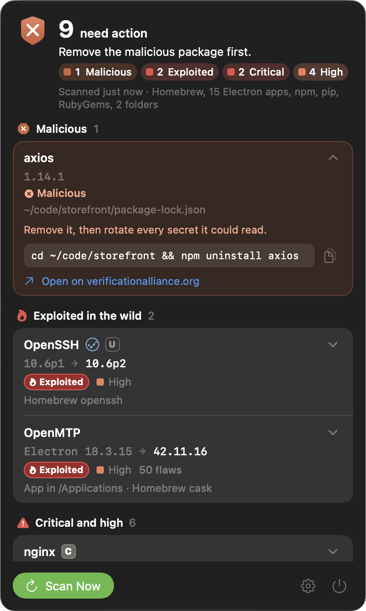
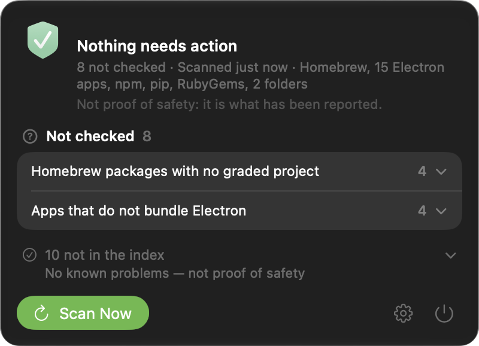

# OSVA Monitor

[](https://github.com/verificationalliance/osva-monitor/actions/workflows/ci.yml)

A native macOS menu-bar app that watches the software on your Mac and tells you what the
[Open Source Verification Alliance](https://verificationalliance.org/) knows about it: malicious packages,
vulnerabilities exploited in the wild, critical and high flaws with the version that fixes them, each project's trust
grade, and whether any of its code is formally verified.

| | |
|---|---|
|  |  |

macOS 26 or later, Apple silicon. Liquid Glass, your appearance and accent colour, no settings to learn.

## What it watches

- **Homebrew** formulae and casks, matched to the projects the site grades (nginx, OpenSSL, curl, Python …).
- **Apps that bundle Electron** (Slack, VS Code, Discord …), checked by the Electron version inside them.
- **Global packages** from npm, cargo and RubyGems, and **every Python** on the Mac (Apple's, Homebrew's, python.org's)
  with the packages installed into it.
- **Project folders you choose**: package-lock.json, yarn.lock, pnpm-lock.yaml, requirements.txt, poetry.lock,
  Pipfile.lock, Cargo.lock, go.sum, Gemfile.lock, composer.lock. A changed lockfile is re-checked within seconds.

## What leaves your Mac

The app downloads the site's public index (every package that has ever had an advisory or a malicious report, about
256,000 names, and every graded project; revalidated daily) and decides **on your Mac** which of your packages are in
it. Only those are named to the API, by
ecosystem, name and exact version. No file paths, app names, or list of what else you have installed are sent.
Settings › What Leaves Your Mac shows exactly what the last scan sent.

Packages that are not in the index are listed as *not in the index: no known problems, not proof of safety*;
software the app cannot check at all (Homebrew packages without a graded project, apps that do not bundle Electron) is
listed as *not checked*. Nothing is ever shown as safe because the app did not recognise it.

## What it tells you to do

For each finding, the smallest upgrade that fixes what can be fixed **on this Mac**, and a command that works where the
package actually lives:

- a package in Apple's Python (part of Xcode, read-only) gets `pip install --user`, which Python loads first, and never a
  release whose `Requires-Python` excludes that Python: on Python 3.9, setuptools 58 is told to go to 78.1.1, and the
  flaw fixed only in 83.0.0 (which needs Python 3.10) is shown as such instead of an upgrade that would fail;
- a package a Homebrew formula installed gets `brew upgrade <formula>`; an externally managed Python (PEP 668) gets
  advice to use a virtual environment or pipx instead of a command pip would refuse;
- a flaw limited to another operating system (*Windows only*) is reported but does not move an installed package; in a
  project folder it still counts, because that code may be deployed anywhere;
- a lockfile dependency gets the command for its package manager, run in its folder; an indirect one gets an update
  within its parent's range, or the override to set.

Every name, version and path in a command is shell-quoted.

## The verified core

Every decision where a bug would mislead you goes through a small core written in **Lean 4**, with theorems that Lean
checks for every input. Lean compiles the same definitions to C, which is linked into the app, so the code that runs
is the code the theorems are about (`core/`).

| Decision | Lean | Theorems |
|---|---|---|
| Version order (`1.0rc1 < 1.0 < 1.0.post1 < 1.0.1`, `10.6p1 < 10.6p2`) | `OSVACore/Version.lean` | reflexive, antisymmetric, transitive |
| Is my version affected, given the fixed version per branch? | `OSVACore/Affected.lean` | a warning always has a version to upgrade to; a version at or past its branch's fix is never flagged; one newer than every fix is never flagged |
| Privacy filter: may this package be sent? | `OSVACore/Select.lean` | marked for sending exactly when it is in the public index |
| URL encoding of package names | `OSVACore/Encode.lean` | output never contains `/ ? # @ :`; decoding gives back the input; at most 3× as long |

All 19 theorems use only Lean's standard axioms (no `sorry`, no trust in compiled code); `scripts/check-core.sh`
re-checks them, audits their axioms and runs the C bridge's tests. What is not proved: the ~100-line C shim that
converts bytes to Lean values (`core/ffi/osva_shim.c`), the Lean compiler and runtime, and the Swift app around the
core (scanners, network, interface), which is covered by tests instead (`app/Tests`).

## Build

Requirements: macOS 26, Xcode 26 or later, [elan](https://github.com/leanprover/elan) (the Lean version is pinned in
`core/lean-toolchain`).

```sh
./scripts/check-core.sh        # build the Lean core, re-check every theorem, audit axioms, test the C bridge
cd app && swift test           # the app's tests
./scripts/build-app.sh         # → app/.build/OSVA Monitor.app (ad-hoc signed; set DEVELOPER_ID and NOTARY_PROFILE to sign and notarize)
```

`OSVAMonitor --capture <dir> --fixtures` writes screenshots of the app's own windows (no Screen Recording permission
needed); it waits for you to click the menu-bar shield, because macOS does not let an app open its own menu-bar panel.

## The site and API

Findings come from [verificationalliance.org](https://verificationalliance.org/): its public index
([`data/app-index.tsv`](https://verificationalliance.org/data/app-index.tsv)) and its REST API
([`/api/v1`](https://verificationalliance.org/api/v1/), OpenAPI at `/api/v1/openapi.json`), built from OSV, the GitHub
Advisory Database, CVE records, CISA KEV and FIRST EPSS. Comments in the code that name `site/formalinformer/…` or
`formalinformer/api/…` refer to the site's own repository, which is not public yet.

## Security

Please report vulnerabilities privately: see [SECURITY.md](SECURITY.md).

## License

[Apache License 2.0](LICENSE).
