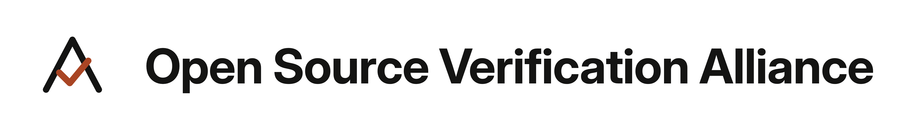
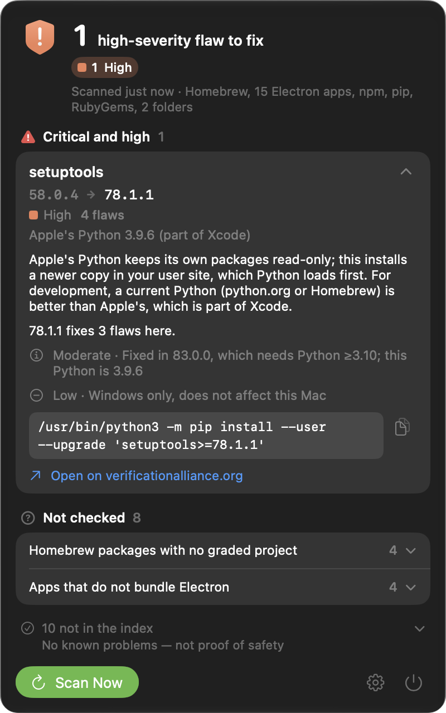
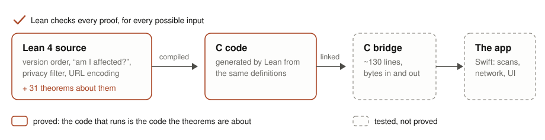

<p align="center">
  <a href="https://verificationalliance.org/">
    <picture>
      <source media="(prefers-color-scheme: dark)" srcset="docs/logo-dark.png">
      
    </picture>
  </a>
</p>

# OSVA Monitor

[](https://github.com/verificationalliance/osva-monitor/actions/workflows/ci.yml)
[](https://verificationalliance.org/#/proof/github.com/verificationalliance/osva-monitor)
[](LICENSE)

Your Mac runs a lot of open-source code you never chose by hand. The Electron inside Slack and VS Code. The Python
that came with Xcode. Whatever Homebrew pulled in. The hundreds of packages in each project's lockfile. Some of it
has known holes. Now and then some of it is malware.

OSVA Monitor lives in the menu bar, checks all of that against public vulnerability and malware data, and shows you
the few things that need you, each with the command that fixes it on this Mac.

<p align="center">
  
</p>

## One example



Apple's Python, the one that ships with Xcode, has setuptools 58.0.4. It has five known flaws. The usual advice is
"upgrade to 84.1.0", and on this Mac that command fails: 84.1.0 needs Python 3.10, and Apple's Python is 3.9.6.

OSVA Monitor works out what can actually be done here:

- **78.1.1** installs on Python 3.9 and fixes the three high-severity flaws, so that is the target.
- The flaw fixed only in 83.0.0 needs a newer Python. The app says so, instead of suggesting an upgrade that would
  fail.
- One flaw affects Windows only. It is listed, but it does not push you to upgrade.
- Apple's Python is read-only, so the command installs the fixed copy into your user site, which Python loads
  first.

<br clear="right">

```sh
/usr/bin/python3 -m pip install --user --upgrade setuptools==78.1.1
```

Every finding works like this: the smallest upgrade that fixes what can be fixed where the package lives, and a
command for that place, whether it is Homebrew, a project folder, a global npm install or one of your Pythons.
Where it can, the app runs that command itself: you review what will change, watch the log, and can stop it, and the
finding is checked again after. A pip upgrade is checked against what depends on the package, before and after, and
one that breaks something can be undone. Apple's Python changes only with Xcode or macOS, so for this one the app
shows the command and runs nothing.

## What it looks at

- **Homebrew** formulae and casks.
- **Apps that bundle Electron**, checked by the Electron version inside them.
- **Apps** in /Applications: their own version, for the apps the site has a record of, and the libraries they bundle
  (Sparkle, Qt, OpenSSL, FFmpeg, CEF, a Java runtime, Python), read from each framework's Info.plist or the library
  itself.
- **Java runtimes** installed on their own: every JDK in /Library/Java/JavaVirtualMachines (Oracle, Temurin, Zulu,
  Corretto, Microsoft …), IntelliJ IDEA's, SDKMAN's, asdf's and mise's, by the version in each one's release file, and
  Homebrew's openjdk formulae. OpenJDK's builds and Oracle's JDK are checked against OpenJDK's advisories; GraalVM, whose
  advisories are separate, is listed under *No record*.
- **Editor and browser extensions**: VS Code, Cursor, VSCodium and Windsurf; Chrome, Brave, Edge, Arc and Vivaldi;
  Firefox. Each is checked on the Mac against the list of extensions known to be malicious, and the npm packages an
  editor extension bundles are checked like any other.
- **Global packages** from npm, cargo and RubyGems, and **every Python** on the Mac (Apple's, Homebrew's,
  python.org's) with what is installed into it.
- **Go programs** and **Rust programs** on the PATH and in Homebrew's Cellar, by what they were built with: the
  modules and Go version in a Go binary's build info, the crates cargo-auditable records. The binaries are only read,
  never run.
- **pipx and uv tools**, each tool's own environment, and **conda** environments (their PyPI packages).
- **MacPorts** and **Nix**, and conda's other packages, matched to the projects the site grades.
- **Project folders you add**: package-lock.json, yarn.lock, pnpm-lock.yaml, requirements.txt, poetry.lock,
  Pipfile.lock, Cargo.lock, go.sum, Gemfile.lock and composer.lock. A changed lockfile is checked again within
  seconds.

## What leaves your Mac


Very little, and nothing until you say so: on first launch the app shows what it reads and what it sends, and
waits for Start. Then it downloads the site's public index, every package that has ever had an advisory or a malware
report (about 256,000 names), and matches your packages against it on the Mac. Only the matches are sent: packages as
ecosystem, name and version, and apps and bundled libraries by the index's own name for them. Extensions are checked on
the Mac only. No file paths, no bundle identifiers, no extension IDs, no list of what else you have. Settings shows
exactly what the last scan sent.

Packages that are not in the index are listed as *not in the index: no known problems, not proof of safety*. Things
the app cannot check at all are listed under *No record*. It never calls something safe because it did not recognise
it.

<br clear="right">

## Updates

The app updates itself with [Sparkle](https://sparkle-project.org/). Once a day it downloads a short feed,
`verificationalliance.org/app/appcast.xml`, that names the latest version. The request tells the site nothing about
your Mac but the app's version. Settings has the switch for the daily check and a button to check now.

Each release is signed with the project's update key, whose public half is built into the app: the zip on GitHub, and
the feed itself. The app takes a new version only if both signatures check. It checks the zip before unpacking any of
it, and it accepts only a zipped app, never an installer package. Someone who could change the web site still could not
make the app install anything else, or put other words in its update window. The zip is also signed with the Developer
ID and notarized by Apple, as before.

`scripts/release.sh` signs a notarized zip and writes the feed. `scripts/test-update.sh` runs a whole update on a Mac,
with a throwaway key and a feed served from the Mac itself, and checks that a changed zip or feed is refused.

## Proved, not only tested

Four kinds of decision, where a bug would mislead you, are made by a core written in [Lean 4](https://lean-lang.org/),
a programming language that is also a proof assistant. Next to the code are theorems about it. Lean checks each proof
for every possible input, not for a sample of them, and refuses to build if one is missing or wrong.

<p align="center">
  
</p>

These decisions of the core are proved:

| What the core decides | What is guaranteed, for every input |
|---|---|
| Which of two versions is newer (`1.0rc1 < 1.0 < 1.0.post1 < 1.0.1`, `10.6p1 < 10.6p2`) | The order never contradicts itself: reflexive, antisymmetric, transitive |
| Whether your version is affected by an advisory, given the ranges the site publishes for it (PostgreSQL: 16 up to 16.15, 17 up to 17.11) | It is flagged as in range if and only if it is in one of them. Without ranges, it is only ever "likely" |
| Which upgrade to suggest, and which advisories an upgrade fixes | The upgrade it suggests is newer than yours and outside the ranges of every advisory it was given. It says an upgrade fixes an advisory only if the upgrade is outside that advisory's ranges |
| Which package names may be sent | The filter passes a name only if it is byte for byte in the public index |
| How a name is put into a URL | The result never contains `/ ? # @ :`, and decoding it gives the name back, so two names never collide |

This is the guarantee about affected ranges, as Lean states it
([`core/OSVACore/Decide.lean`](core/OSVACore/Decide.lean)):

```lean
/-- A warning "inside a range" means the version lies in one of the advisory's published ranges. -/
theorem verdict_inRange_sound {v : Bytes} {a : Advisory} (h : verdict v a = .inRange) :
    ∃ rs, a.ranges = some rs ∧ ∃ r ∈ rs, InRange v r
```

In words: if the core says your version `v` is inside a range of advisory `a`, then `a` has published ranges and `v` is
in one of them. A companion theorem says the converse: a version in one of them is always flagged. Both hold for every
version string, including the strange ones nobody thought to test.

**What this means for the app.**

- A version is flagged as affected only if it lies inside an affected range the site publishes for that vulnerability.
- Every version it suggests upgrading to is newer than yours and lies outside the published ranges of every advisory
  it says that version fixes.
- Names in request URLs never contain /, ?, #, @ or :.
- Malicious packages are flagged from the malware record itself.

Inside and outside are in the core's version order. One exception to the second: a Go or Rust program, or a uv tool,
may be built again at its installed version, which brings newer versions of what it was built with. That is offered
only when every flagged package is one of those
([`ProgramFindings.swift`](app/Sources/OSVAKit/Scan/ProgramFindings.swift)). The names in an exact-version check travel
in the request's JSON body, not in a URL.

What the core cannot check is listed apart, under *Not checked against published ranges*, and never counted. A flaw
the site publishes no ranges for is *likely affected* when the fixed versions its issuer names say so, and a version
shown for it is one the core checked against them. Any other flaw the core cannot check is *reported, not checked*,
with no version and no command: no ranges and no fixed version that flags yours, ranges that cannot be read, Maven or
Packagist versions the core may order differently, or more flaws than the server lists. An exploited or critical one
gets an amber mark. On the project and product paths, an advisory that states no versions shows only if it is
exploited, or beside another finding.

**How the app is held to it.** In the app's code, only the verified core can make a version to upgrade to, and the
commands are built only from such versions: the types allow nothing else, and a guard test scans the source for ways
around them. Rebuilds, the exception above, may use the installed version. A report saved on disk is shown as it was
saved until the app scans again. The type is `CheckedUpgrade` in `Core.swift` and the test is `ClaimsTests`;
`scripts/claims-mutants.sh` breaks the rules one at a time and checks that the test fails. This part is held by types
and tests, not proved in Lean.

**The proved code is the code that runs.** Lean compiles the same definitions to C, and that C is linked into the
app. There is no hand-written Swift copy that could drift away from what was proved. About 190 lines of C pass
bytes between Swift and Lean. That bridge is the only unproved code on the path, and it has its own tests.

**Anyone can re-check it.** `scripts/check-core.sh` rebuilds the core, which makes Lean check all 47 proofs again. It
then confirms that they rest only on Lean's three standard axioms (no `sorry`, nothing assumed without proof) and runs
the bridge's tests. CI does the same on every push.

**What is not proved.** The Lean compiler and runtime, the C bridge, the Swift code that sends decisions to the core,
which advisories the server matches to a package, and the rest of the app: reading Homebrew, lockfiles and Pythons,
the network, the interface. Those are covered by tests. The data comes from OSV, the GitHub Advisory Database and NVD.
The proofs say the core reasons correctly about the data it is given, not that the data is right.

The server the app talks to uses the same version order, and its implementation is tested against this Lean core on
106,411 version pairs.

## Build

You need macOS 26, Xcode 26 or later, and [elan](https://github.com/leanprover/elan). The Lean version is pinned in
`core/lean-toolchain`; `build-app.sh` builds the core with that toolchain, and links the app with its runtime.

```sh
./scripts/check-core.sh   # re-check every proof, audit the axioms, test the bridge
cd app && swift test      # the app's tests
./scripts/build-app.sh    # app/.build/OSVA Monitor.app, ad-hoc signed
```

Set `DEVELOPER_ID` and `NOTARY_PROFILE` for a Developer ID signature and notarization; the script's header has the
details. The app icon is `app/Resources/AppIcon.icon`, a Liquid Glass icon you edit in Icon Composer; `build-app.sh`
compiles it with `actool`. `OSVAMonitor --capture <dir> --fixtures` writes screenshots of the app's own windows. It
waits for you to click the menu-bar shield, because macOS does not let an app open its own menu-bar panel.

| Folder | What is in it |
|---|---|
| `core/` | The Lean core (`OSVACore/*.lean`), its C header and the C bridge |
| `app/` | The Swift package: `OSVAKit` (scanning, the API), `OSVAMonitorUI`, the app, tests |
| `scripts/` | `check-core.sh`, `build-app.sh`, `release.sh` (the update feed), `test-update.sh` |

## Where the data comes from

Findings come from [verificationalliance.org](https://verificationalliance.org/): its public index
([`data/app-index.tsv`](https://verificationalliance.org/data/app-index.tsv)) and its REST API
([`/api/v1`](https://verificationalliance.org/api/v1/), OpenAPI at `/api/v1/openapi.json`). Those are built from OSV,
the GitHub Advisory Database, CVE records, CISA KEV and FIRST EPSS. Comments in the code that name
`site/formalinformer/…` or `formalinformer/api/…` refer to the site's own repository, which is not public yet.

## Security

Please report vulnerabilities privately, as described in [SECURITY.md](SECURITY.md).

## License

[Apache License 2.0](LICENSE).
